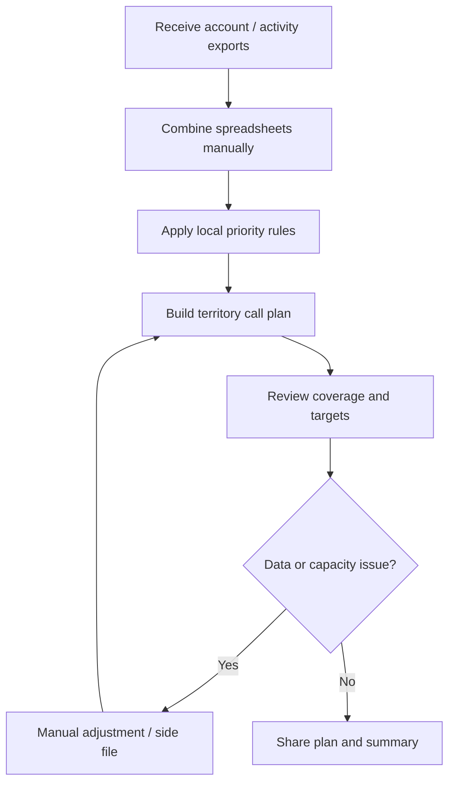
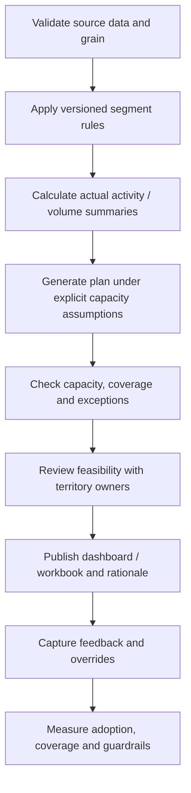

# Process Improvement Case — Commercial Capacity Planning

> This is a hypothetical workflow proposal using synthetic data. It is not an observed company process or evidence of validated field-team pain.

## Problem hypothesis
When account priorities, contact targets and resource constraints are managed through disconnected spreadsheets, a territory manager may struggle to explain allocation logic or reconcile the plan with historical activity. Explicit rules and grain-safe summaries may improve transparency; that value requires real-user validation.

## As-is (hypothesised)

## To-be (proposed)

## Improvement opportunities
| Opportunity | Hypothesis to evaluate | Control |
|---|---|---|
| Versioned segment rules | Make priority more explainable | Review thresholds and segment stability |
| Explicit capacity model | Make allocation assumptions visible | Reconcile plan total to validated capacity |
| Actual-vs-target coverage view | Surface gaps consistently | Validate targets and reporting period with owners |
| Grain-safe SQL | Prevent inflated rollups | Aggregate call and account-month tables before joining |
| Excel plus dashboard | Help reviewers inspect summaries and detail | Reconcile both outputs to pipeline source |
| Feedback / override log (future) | Expose feasibility issues | Record reason, owner and disposition |

## Prioritisation
1. Confirm data definitions and grain.
2. Make segment thresholds and call-plan assumptions visible.
3. Test feasibility with real field availability, travel and contact constraints.
4. Capture user feedback and override reasons.
5. Evaluate real outcomes with a credible comparison before making lift or ROI claims.

## Pilot measures to consider
Data completeness; share of accounts with valid segment inputs; planned versus feasible capacity; coverage attainment by segment; number and reasons for plan overrides; user-reported clarity / feasibility; and business outcomes measured with an appropriate experiment or quasi-experiment.

## Impact boundary
The project demonstrates a transparent planning heuristic and reporting stack. No field team adopted it, no efficiency or revenue benefit has been demonstrated, and synthetic volume-per-call ratios are not causal effectiveness measures.
